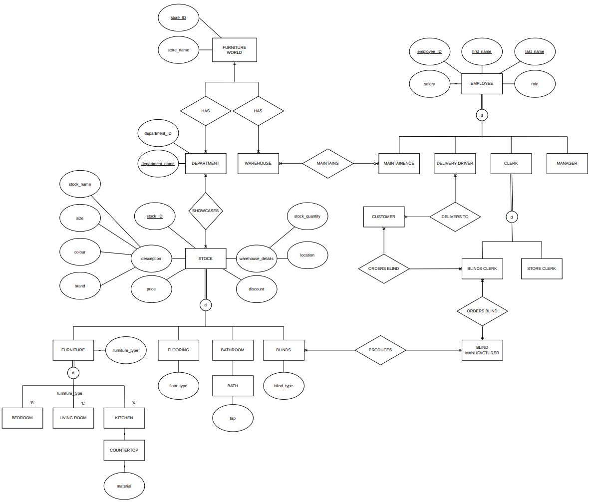

# Furniture World Database Project

A relational database system designed to transition **Furniture World** from manual, paper-based records to a centralized, normalized database architecture.

---

## Overview

This project is based off a furniture store I visited recently which still relies on paper-based records. For the purpose of this assignment, I will call it Furniture World. The store is comprised of different departments including Bedroom, Flooring, Bathroom, Living Room and Kitchen. Each department has a showroom that showcases the stock inside it. Every piece of stock has an ID, Name, Description, Colour, Brand, Size, Stock Quantity, Location, Price and Discount.  

The Flooring and Bathroom departments are not listed as furniture like the others but share the attributes of the other stock. All Flooring department items and the Kitchen countertops have a material, Bathroom baths have a tap. All the current stock is stored in a warehouse beside the store, stock not available gets ordered in from external suppliers. There is another business operating inside the store that sells Blinds. There are different variations of blinds available these include Venetian, Wood and Roller blinds. These blinds are made to order according to the customers specifications. The Blinds Clerk contacts an external manufacturer to produce the blind and return it to the store for delivery to the customer. Right now, they only work with one manufacturer, and all the samples come from them. 

The Store is made up of several different Employees. There is a Store Manager who oversees both the main store and the blinds store. Clerks handle the day-to-day transactions with customers, There are clerks for both stores. A Clerk can be responsible for either the Main Store or Blind Store but not both. The Blind Manufacturer receives a specification from the Blind Clerk and only then can start working on the product. There is a Maintenance Employee who oversees the storage of furniture, flooring and bathroom items in the warehouse and maintains the main building. There is a Delivery Driver that delivers products from the store to customers but only when they get the customer contact details from a Clerk. Every employee has an ID, first name, last name, salary and role.

---

## Entity-Relationship Diagram

